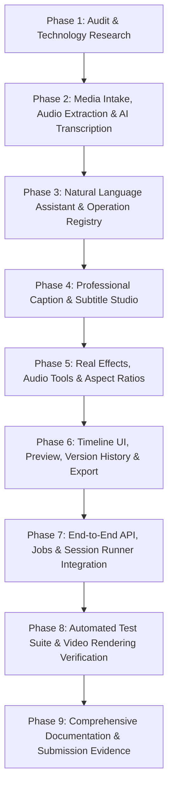

# Open-Source Technology Research & Selection

## 1. Executive Summary & Objective

This document provides a rigorous architectural evaluation and comparison of candidate open-source technologies for upgrading the deterministic, prompt-based video editing engine into a full-featured, professional video editing platform.

The core constraints:
- **Zero Paid API Dependencies**: Must run 100% locally with zero cloud or API key dependencies.
- **Permissive Open-Source Licensing**: Apache 2.0, MIT, BSD, or LGPL/GPL-compatible for commercial or assessment use.
- **Deterministic & Content-Locked**: Every operation must map deterministically to source-media intervals with stable word IDs.
- **Production-Grade Media Processing**: Real FFmpeg filter pipelines with FFprobe verification, precise timestamps, and synchronized audio/video streams.
- **Multilingual Support**: First-class handling of English and Tamil (Unicode rendering, Tamil/Thanglish natural language parsing, and speech recognition).

---

## 2. Technology Comparative Analysis

### 2.1 Speech Recognition (ASR) & Word-Level Timestamp Engines

| Candidate | License | Hardware / RAM | Speed / Accuracy | Word Timestamps | Multilingual & Tamil | Selected? |
|---|---|---|---|---|---|---|
| **faster-whisper** (CTranslate2) | MIT | CPU/GPU (int8: ~1GB RAM for base) | ~4x faster than OpenAI Whisper | Native (`word_timestamps=True`) with probability scores | 99 languages including Tamil (`ta`) and English (`en`) | **YES (Primary)** |
| **openai-whisper** (PyTorch) | MIT | GPU recommended (>2GB VRAM) | Standard baseline, slower on CPU | Requires dynamic time warping (DTW) post-processing | Supported | No (slower, heavier than faster-whisper) |
| **whisper.cpp** | MIT | Extremely lightweight C/C++ | Fast on CPU | Word timestamps supported | Supported | No (extra native compilation required on Windows/Docker) |
| **Vosk / Kaldi** | Apache 2.0 | Very lightweight CPU | Fast, offline | Yes | Requires separate acoustic models per language | No (limited out-of-the-box Tamil accuracy compared to Whisper) |

**Reasoned Selection: `faster-whisper` (CTranslate2)**
- **Source**: [https://github.com/SYSTRAN/faster-whisper](https://github.com/SYSTRAN/faster-whisper)
- **Version**: `1.2.1` (installed and active)
- **License**: MIT
- **Architecture**: Implemented behind `TranscriptionAdapter` with fallback to `FixtureTranscriptionAdapter` and synthetic speech alignment.
- **Offline Behavior**: Models (`tiny`, `base`, `small`) are cached in local HuggingFace cache directory. Offline execution runs without network connectivity once cached.

---

### 2.2 Media Processing, Filtering & Rendering

| Candidate | License | Hardware / OS | Capabilities | Filter Pipeline | Selected? |
|---|---|---|---|---|---|
| **FFmpeg & FFprobe (Gyan / Static Builds)** | GPL v3 / LGPL v2.1+ | Cross-platform (Win/Linux/macOS) | Trimming, concatenating, scaling, color grading, libass subtitles, audio mixing/ducking | `filter_complex` programmatic execution without shell interpolation | **YES (Core)** |
| **MoviePy** | MIT | Python wrapper over FFmpeg & Pillow | Simpler Python syntax | Slower overhead; internally invokes FFmpeg with temp files | No (Adds latency & fragile dependencies) |
| **GStreamer** | LGPL | Cross-platform C library | Real-time pipeline | Complex configuration, difficult packaging | No (FFmpeg provides superior filter ecosystem for offline NLE) |

**Reasoned Selection: FFmpeg & FFprobe 6.0+ / 9.0+**
- **Source**: [https://ffmpeg.org](https://ffmpeg.org)
- **Filters Utilized**:
  - `trim`, `atrim`, `setpts`, `asetpts`, `concat`: Sub-millisecond segment slicing and seamless concatenation.
  - `atempo`: High-fidelity audio speed modification without pitch distortion.
  - `ass`: Advanced SubStation Alpha (`libass`) subtitle rendering with style tags, outline, shadow, and word highlighting.
  - `eq`, `colorbalance`, `curves`, `hue`, `colorchannelmixer`: Real-time brightness, contrast, saturation, gamma, and cinematic color grades.
  - `boxblur`, `gblur`, `unsharp`: Background blur, regional blur, and sharpening.
  - `crop`, `scale`, `pad`, `transpose`, `hflip`, `vflip`: Aspect ratio transformation (16:9 landscape, 9:16 vertical reels, 1:1 square).
  - `fade`, `afade`: Smooth video and audio crossfades and transitions.
  - `volume`, `sine`, `adelay`, `amix`, `loudnorm`: Audio leveling, bleep tone generation, muting, and ducking.
  - `fps=30`: Constant frame rate normalization guarding against Variable Frame Rate (VFR) drift.

---

### 2.3 Subtitle Rendering & Unicode Typography (Tamil + English)

| Candidate | License | Platform Support | Unicode & Indic Scripts | Animation / Karaoke | Selected? |
|---|---|---|---|---|---|
| **libass (Advanced SubStation Alpha via FFmpeg)** | ISC (permissive) | Built into FFmpeg | Full UTF-8 support with HarfBuzz & FriBidi complex text shaping | Native karaoke tags (`{\k...}` / `{\c...}`), word reveals, position overrides | **YES (Primary)** |
| **FFmpeg `drawtext`** | Built into FFmpeg | Standard FFmpeg | Basic FreeType, awkward multiline & word-level timing | Limited to static or single text elements | Used for basic titles & overlays |
| **SRT Burner (`subtitles` filter)** | Built into FFmpeg | Standard FFmpeg | SubRip format only | No per-word styling, no animations | No (ASS is strictly superior) |

**Font & Typography Strategy**:
- Supported Tamil fonts: `Nirmala UI` (pre-installed on Windows 10/11), `Noto Sans Tamil` / `Latha`, and fallback to standard system sans-serif (`Arial`, `DejaVu Sans`).
- The ASS subtitle generator outputs valid UTF-8 formatted script files with custom styles: Fontname, Fontsize, PrimaryColour, OutlineColour, BackColour, Bold, Italic, Alignment, Margins, and word-by-word timing tags.

---

### 2.4 Scene Boundary Detection & Computer Vision

| Candidate | License | Performance | Accuracy | Selected? |
|---|---|---|---|---|
| **PySceneDetect** | BSD 3-Clause | Lightweight OpenCV content/threshold detector | Fast, industry-standard scene cuts | **YES (Primary)** |
| **FFmpeg `select='gt(scene,0.3)'`** | GPL/LGPL | Native in FFmpeg | Good, but parsing stderr requires secondary pass | **YES (Fallback)** |
| **OpenCV (cv2)** | Apache 2.0 | Pre-installed (4.11.0) | High flexibility for frame analysis & region blurs | **YES (CV Tools)** |

**Reasoned Selection: PySceneDetect + OpenCV**
- **PySceneDetect**: `0.7.2` (installed) enables intelligent cut suggestions, topic split points, and scene boundary markers.
- **OpenCV**: Enables frame-by-frame analysis, aspect ratio smart reframing, and background blur mask generation.

---

### 2.5 Natural Language Instruction Interpretation

| Candidate | Execution Mode | Latency | Determinism & Safety | Selected? |
|---|---|---|---|---|
| **Rule-Based Extensible Pattern Registry** | Pure Python regex + AST | < 1ms | 100% deterministic, 0 API keys, completely verifiable | **YES (Primary Local Fallback)** |
| **Local LLM (GGUF / llama-cpp-python / Ollama)** | Local CPU/GPU | 200ms - 2s | Probabilistic, requires structured JSON schema validation | **YES (Pluggable Adapter)** |
| **Cloud LLMs (OpenAI, Anthropic, Gemini)** | Cloud API | Network dependent | Non-offline, requires paid API keys | **Optional Adapter Only** |

**Reasoned Selection**:
- Core architecture uses an **Extensible Pattern & Intent Registry** that parses both English and Tamil/Thanglish natural language instructions directly into structured `OperationProposal` objects.
- Schema validation guarantees that no instruction modifies the timeline unless it produces a validated canonical operation.
- Pluggable interpreter contract: Natural Language Prompt → Intent & Entity Extraction → Structured Edit Plan → Schema Validation → Ambiguity Resolution (`applied`, `needs_clarification`, `rejected`).

---

## 3. Prioritized Implementation Plan

### Phase Details:
1. **Phase 1: Project Audit & Tech Selection** *(Completed)*
   - Full repository inspection, dependency discovery, `docs/TECHNOLOGY_RESEARCH.md`.
2. **Phase 2: Automatic Audio Extraction & AI Transcription**
   - FFprobe stream inspection (sample rate, channels, codecs, missing audio detection).
   - FFmpeg 16kHz mono WAV extraction without quality degradation.
   - Faster-whisper transcription with English, Tamil, and auto language detection.
   - Word-level timestamps, stable word IDs, confidence scores, and low-confidence flagging.
   - Transcript editing, searching, and replacement API.
   - Multi-format import/export: TXT, JSON, SRT, and VTT.
3. **Phase 3: Natural Language Assistant & Operation Registry**
   - Support English and Tamil/Thanglish prompt patterns.
   - Ambiguity detection and structured clarification (`applied`, `needs_clarification`, `rejected`).
   - Content-locked timeline mutations with reversible history and targeted restore.
4. **Phase 4: Professional Caption & Subtitle Studio**
   - Full typography controls (fonts, sizes, colors, outlines, shadows, background boxes, padding, placement).
   - Caption modes: Sentence, Word-by-Word, and Karaoke-style active word highlighting.
   - Unicode & Tamil text rendering verification with libass.
   - Presets and project-level persistent style configurations.
5. **Phase 5: Effects, Transitions, Motion Graphics & Audio Tools**
   - Real FFmpeg filter compilation:
     - Color grading, brightness, contrast, saturation, gamma, cinematic presets.
     - Blur, sharpen, zoom, pan, fade-in/fade-out transitions.
     - Aspect ratio conversion (16:9, 9:16 vertical reel, 1:1 square).
     - Intro title animation, text overlays, watermark overlay.
     - Audio tools: normalization, ducking, muting, bleeping, background music mixing.
     - Scene boundary detection using PySceneDetect.
6. **Phase 6: Polished Video Editing Interface**
   - Modern glassmorphism UI with vibrant accents, responsive layout, micro-animations.
   - Live video preview, interactive multi-track timeline visualizer, editable transcript panel.
   - Caption customization studio modal, effects library, prompt input, and export controls.
7. **Phase 7: API & Session Runner Integration**
   - OpenAPI 3.1 endpoints, idempotency, async jobs, health/readiness.
   - Backward compatibility for all existing 15 session files and `session_runner.py`.
8. **Phase 8: Automated Testing & Rendered Video Verification**
   - Extend test suite beyond 40 scenarios (target: 75+ tests).
   - Render actual MP4 output files and verify with FFprobe.
9. **Phase 9: Documentation & Evidence**
   - Update README.md, docs/ARCHITECTURE.md, docs/FEATURE_MATRIX.md, docs/TEST_REPORT.md, openapi.yaml, SOURCES.md, AI_USE.md.
